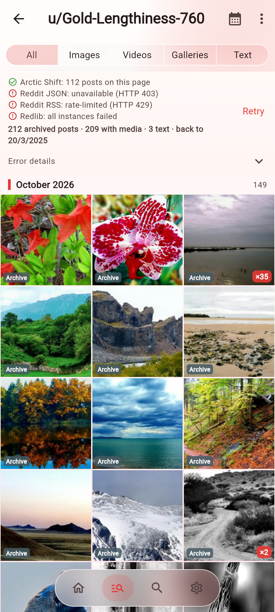
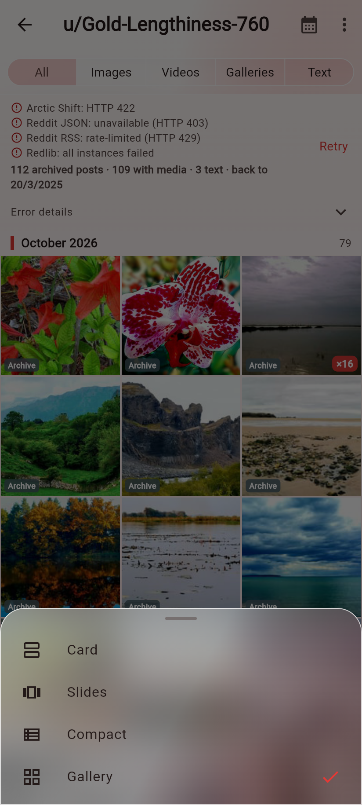
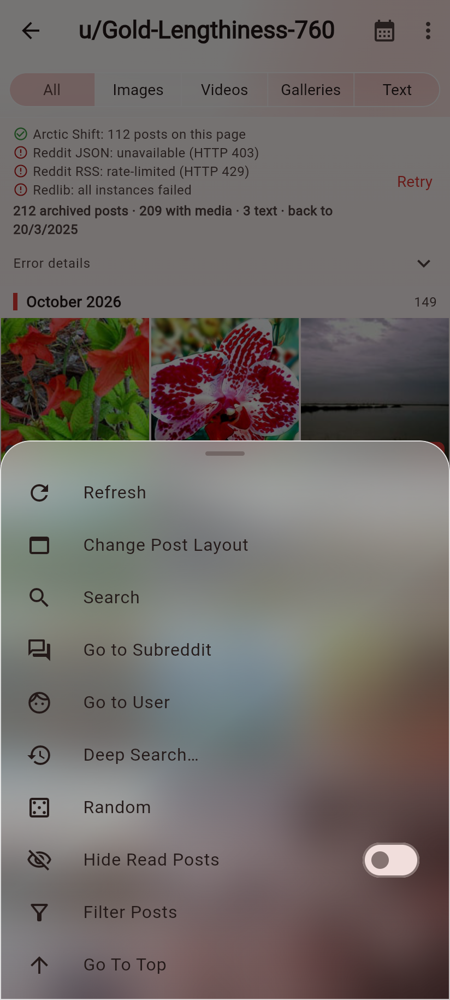
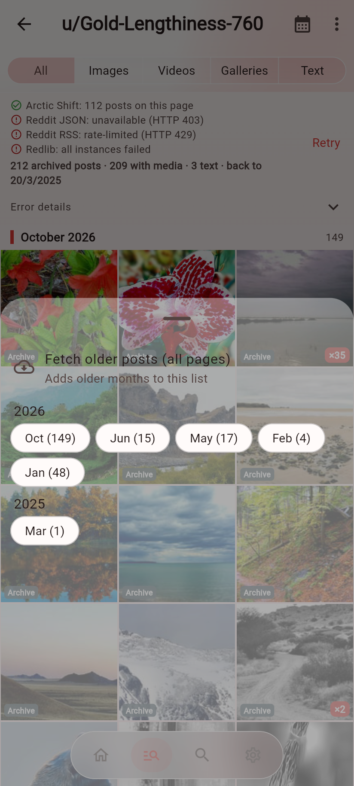
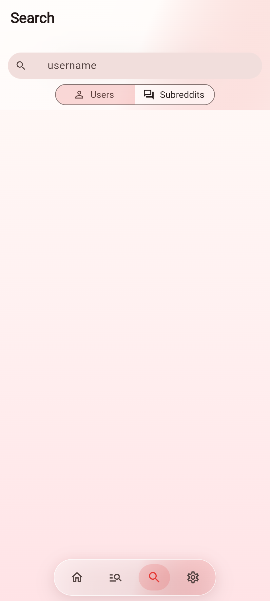
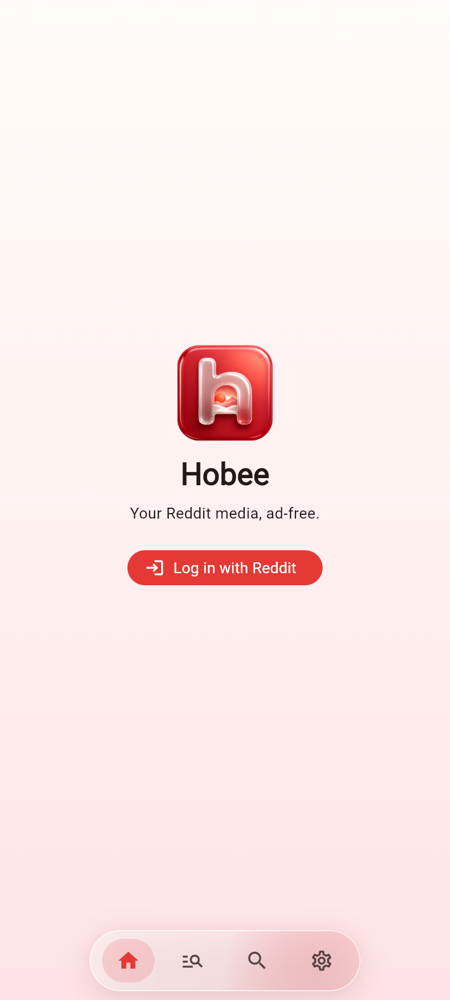
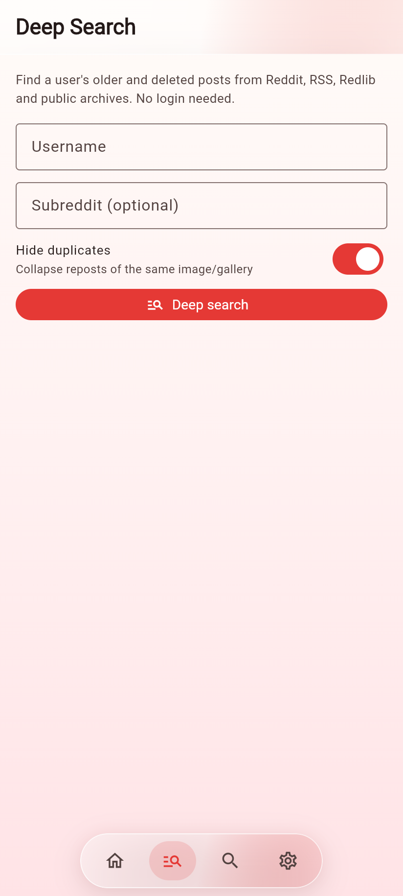
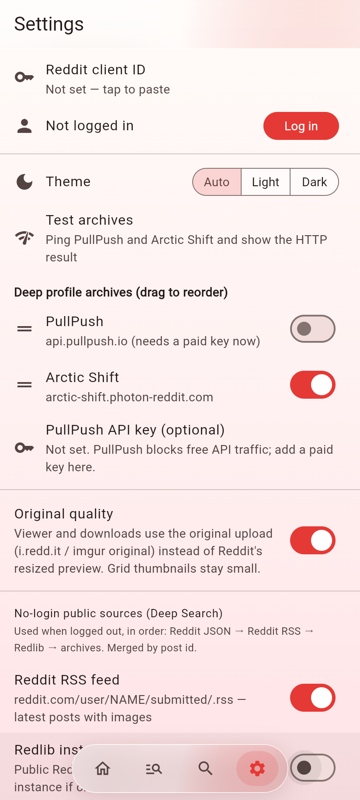
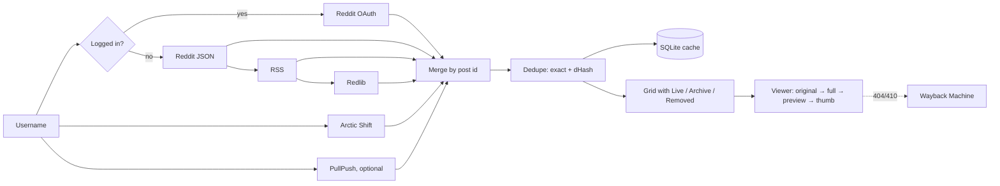

<p align="center">
  
</p>

<h1 align="center">Hobee</h1>

<p align="center">
  A Reddit media gallery for Android that I built for myself. No ads, no analytics, no tracking.
</p>

<p align="center">
  
  
  
  
</p>

Hobee shows a Reddit user's or subreddit's posts as a clean photo/video grid. Its main trick is **Deep Search**: it pulls a profile's history from the live Reddit sources *and* public archives, merges everything by post id, removes duplicates and tells you which posts are still live and which ones are gone.

I'm a student and this is a hobby project. It works well for me, but read [Known issues](#known-issues) before you expect too much.

## Table of contents

- [Features](#features)
- [Screenshots](#screenshots)
- [Install](#install)
- [Build from source](#build-from-source)
- [Get your own Reddit API key](#get-your-own-reddit-api-key)
- [Usage](#usage)
  - [Home](#home)
  - [Deep Search](#deep-search)
  - [Search](#search)
  - [Settings](#settings)
- [Supported sources](#supported-sources)
- [How it works](#how-it-works)
- [Image upscaling](#image-upscaling)
- [Known issues](#known-issues)
- [FAQ](#faq)
- [Roadmap](#roadmap)
- [The journey](#the-journey)
- [Changelog](#changelog)
- [Contributing](#contributing)
- [Credits](#credits)
- [License](#license)
- [Disclaimer](#disclaimer)

## Features

- **Deep Search** for a username: Reddit JSON, Reddit RSS, Redlib and public archives (Arctic Shift, optionally PullPush), merged by post id
- Every tile is labelled **Live**, **Archive** or **Removed**, so you know what still exists on Reddit
- **Hide duplicates**: exact URL matching plus perceptual hashing (dHash), so reposts of the same picture show up once
- **Original quality** mode: the viewer and downloads use the original upload (i.redd.it / imgur original) instead of Reddit's resized preview
- Filters for All / Images / Videos / Galleries / Text, plus a "show posts between" date filter
- Month headers and a year/month **jump** sheet for long histories
- Four layouts: Card, Slides, Compact, Gallery
- **Image upscaling (super resolution)** in the viewer: 2x, 3x or 4x, right on your phone, no server, no limits. Drag the divider to compare before and after, long-press to peek at the original, save as a full quality PNG. See [Image upscaling](#image-upscaling)
- Full-screen viewer with swipe, galleries, videos and downloads (to `Pictures` and `Movies`)
- **Clean downloads** (Settings, on by default): saved pictures have their EXIF, GPS, XMP, IPTC and comments removed and nothing is added, so a file does not say where it came from. Names are a plain timestamp like `20261025_233900.jpg`. Videos are saved as they are
- Local SQLite cache, so posts you've already loaded open instantly and you can search them offline
- Light / Dark / Auto theme
- Works without logging in. Logging in with Reddit (bring your own client ID) unlocks the Home feed and the Search tab

## Screenshots

| Deep Search | Viewer | Layouts |
|---|---|---|
|  |  |  |

| Menu | Jump to month | Search |
|---|---|---|
|  |  |  |

| Home (logged out) | Deep Search (start) | Settings |
|---|---|---|
|  |  |  |

The photos are SFW nature posts from a public profile. You can see real source errors in the status lines (Reddit JSON 403, RSS 429 and so on). That's normal, and it's why Hobee falls back across several sources.

## Install

1. Download `Hobee-1.3.10-arm64.apk` from the [Releases](../../releases) page. It's the build for almost every phone from the last ~6 years (arm64-v8a).
2. Open it on your phone and allow "install unknown apps" for your browser or file manager.
3. That's it. Deep Search works straight away without logging in.

The APK is split per ABI because the universal one was over 25 MB. If you have an old 32-bit phone, build it yourself (see below).

## Build from source

You need:

- Flutter **3.47.8**
- JDK **17**
- Android SDK (whatever Flutter's `flutter doctor` asks for)

```bash
git clone https://github.com/Alokxyz1112/hobee.git
cd hobee
flutter pub get
flutter analyze
flutter test
flutter build apk --release --split-per-abi --target-platform android-arm64
```

The APK ends up in `build/app/outputs/flutter-apk/app-arm64-v8a-release.apk`.

**Signing:** `android/app/build.gradle.kts` signs the release with `android/key.properties` if that file exists, and falls back to the debug key otherwise. So a plain clone builds fine. To sign with your own key, create `android/key.properties`:

```properties
storePassword=...
keyPassword=...
keyAlias=...
storeFile=/absolute/path/to/your.jks
```

`key.properties`, `*.jks` and `local.properties` are git-ignored. Please don't commit them.

## Get your own Reddit API key

You only need this if you want to **log in** (for the Home feed and the Search tab). Deep Search works without it.

Reddit doesn't let one app's key be shared by everyone, so each person makes their own. It's free:

1. Read the [Data API Wiki](https://support.reddithelp.com/hc/en-us/articles/16160319875092-Reddit-Data-API-Wiki) and the [Data API Terms](https://redditinc.com/policies/data-api-terms).
2. Go to [reddit.com/prefs/apps](https://www.reddit.com/prefs/apps) (you have to be logged in) and click **create another app**.
3. Choose **installed app**. Not "web app" and not "script", because Hobee has no client secret.
4. Set the redirect URI to exactly:
   ```
   redditgallery://auth
   ```
5. Save it and copy the **client ID**, the short string under the app name.
6. In Hobee, open **Settings → Reddit client ID**, paste it, then tap **Log in**.

Reddit may ask you to submit an access request before new apps work. Mine is still pending as I write this, which is the whole reason the no-login path exists.

You don't need a key for:
- **Arctic Shift**: free and open, no key
- **Redlib**: public front-ends, no key
- **PullPush**: the key is optional. They moved free API traffic behind a paid key, so it's off by default.

## Usage

The app has four tabs in the bottom pill. They're icons only; long-press one to see its name.

### Home

When you're logged in, this is your Reddit feed. The ⋮ menu has:

- **Refresh**
- **Change Post Layout**: Card, Slides, Compact or Gallery
- **Change Sort Type**
- **Filter Posts**, **Filter by date**
- **Hide Read Posts / Show Read Posts**
- **Go To Top**, **Go to Subreddit**, **Go to User**, **Random**

When you're logged out, it shows a "Log in with Reddit" button.

### Deep Search

1. Type a username (with or without `u/`).
2. Hobee asks the live sources and the archives at the same time and keeps adding results as they arrive.
3. The status lines at the top show what each source did (ok, 403, rate-limited and so on). **Retry** asks them again.
4. Use the chips (All / Images / Videos / Galleries / Text) to filter. **Hide duplicates** removes reposts.
5. Tap the calendar icon to jump to a year/month. **Load more** adds older months.
6. Your recent deep searches are saved, so you can open them again quickly.

The tiles say **Live** (still on Reddit), **Archive** (only found in an archive) or **Removed** (the media is gone; Hobee tries the Wayback Machine for it).

### Search

Search for **Users** or **Subreddits**. This uses Reddit's API, so for now it needs you to be logged in. There's also **Search cached posts**, which looks through what you've already loaded (title or subreddit), offline.

### Settings

| Setting | What it does |
|---|---|
| **Reddit client ID** | Your own installed-app client ID (see above). Needed for login. |
| **Log in / Log out** | Reddit OAuth login with your client ID. |
| **Theme** | Auto (follow the system), Light or Dark. |
| **Test archives** | Pings PullPush and Arctic Shift and shows the HTTP result. Useful when Deep Search finds nothing. |
| **Deep profile archives** | Turn PullPush and Arctic Shift on or off, and drag them to reorder. PullPush is off by default. |
| **PullPush API key (optional)** | Paste a paid PullPush key if you have one. |
| **Original quality** | The viewer and downloads use the original file instead of Reddit's resized preview. Grid thumbnails stay small either way. |
| **Reddit RSS feed** | Uses `reddit.com/user/NAME/submitted/.rss` for the latest posts when logged out. |
| **Redlib instances** | Uses public Redlib front-ends, and tries the next one if one fails. |
| **Preferred Redlib instance** | Which instance to try first (default `redlib.ducks.party`). |
| **Clear cached posts** | Wipes the local SQLite cache. |

The order used when logged out is: Reddit JSON → Reddit RSS → Redlib → archives, merged by post id.

## Supported sources

| Source | Needs key? | Used for | Notes |
|---|---|---|---|
| Reddit OAuth API | Your client ID | Home, Search, live posts | Only when logged in |
| Reddit JSON (`.json`) | No | Live posts | Often returns 403 now |
| Reddit RSS | No | Latest posts | Only recent posts; thin records |
| Redlib | No | Live posts | Public instances come and go |
| Arctic Shift | No | Full history | Main archive |
| PullPush | Optional (paid) | Full history | Off by default |
| Wayback Machine | No | Removed media | Last-resort fallback |

Media hosts: i.redd.it, preview.redd.it, Reddit galleries, v.redd.it videos and imgur. For embeds like redgifs, gfycat and imgur albums, Hobee shows the oEmbed thumbnail.

## How it works

### lib/ file by file

| File | What's in it |
|---|---|
| `main.dart` | App start, theme, the four tabs (`IndexedStack`) and the logged-out prompt |
| `nav_bar.dart` | The floating icon-only nav pill (tooltips and semantics labels) |
| `nav.dart` | Shared tab/navigation state |
| `glass.dart` | The frosted background and blur helpers |
| `api.dart` | Reddit API client, request pacing, 429 handling |
| `auth.dart` | Installed-app OAuth login and token storage |
| `public_sources.dart` | Reddit JSON, RSS and Redlib (instance list) for the no-login path |
| `archive.dart` | Arctic Shift and PullPush clients, Deep Search merge, cursors, media checks |
| `archive_ui.dart` | Live/Archive/Removed labels and source status UI |
| `models.dart` | Post model, media extraction, original-quality URL mapping |
| `dedupe.dart` | Exact-key and dHash duplicate detection |
| `db.dart` | SQLite cache (posts, hashes, recent searches) |
| `feed.dart` | Paging for the Home feed and listings |
| `posts_view.dart` | The post list/grid with its menus, layouts and month headers |
| `gallery.dart` | Grid tiles |
| `filters.dart` | Type and date filters |
| `deep_search.dart` | The Deep Search screen |
| `source_bar.dart` | The per-source status lines |
| `search.dart` | Users/Subreddits search and cached search |
| `viewer.dart` | Full-screen viewer, image fallback chain, video page |
| `download.dart` | Saving to Pictures and Movies |
| `clean.dart` | Clean downloads: metadata stripping and timestamp file names |
| `settings.dart` | The Settings screen |

### Data flow



### Deep Search merge

Every source returns posts, and they're merged by **Reddit post id**. RSS and Redlib give "thin" records (title, link, maybe one image), while the archives give the full JSON (gallery items, media metadata, timestamps). When the same id shows up in both, the thin row gets replaced by the full archive record.

A profile query also searches the subreddit `u_NAME`. That's where profile posts live, and author search alone misses some of them.

### Duplicate detection

1. **Exact keys**: same normalised media URL means duplicate.
2. **dHash**: each image is shrunk to 9×8 grayscale and adjacent pixels are compared, which gives a 64-bit hash. Two images whose hashes differ in **≤ 6 bits** (Hamming distance) count as the same picture. For galleries, up to 4 images are hashed.
3. The hashes are cached in SQLite, so nothing gets hashed twice.

### Original quality

Most of this I learned from reading gallery-dl and bdfr:

- `preview.redd.it/ID.jpg?...` → `i.redd.it/ID.jpg` (the original, without the resize params)
- imgur: strip the size suffix (`s b t m l h r g`) from 6/8-character ids, e.g. `abc1234h.jpg` → `abc1234.jpg`
- galleries: build the i.redd.it URL from each item's id and its mime type (`image/png` → `.png` and so on)
- `&amp;` in URLs gets unescaped (otherwise Reddit returns 403)

### When is media "gone"?

Hobee checks the media URL:

- **404 / 410**, or a redirect to Reddit's "removed" image → **gone**, so it tries the Wayback Machine (`id_` raw URLs)
- **2xx** → alive. This is a normal GET (the body is dropped as soon as the status comes back), not a 1-byte Range request. preview.redd.it happily answers a Range request with 206 even when the picture was deleted, and only a normal GET tells you the truth (404 plus a grey placeholder).
- **403 / 429 / 5xx** → *unsure*, so it isn't marked gone (rate limits aren't deletions). It waits a bit and asks once more first.

At most 6 of these checks run at the same time, so scrolling fast through a big profile doesn't hammer Reddit or the Wayback Machine. If nothing works, the tile says **Image gone** instead of spinning forever. Tap it to check again, or turn on **Hide gone images** in the filter sheet (Deep Search only) to drop those tiles. Preview links are signed (the `s=` part), so Hobee never edits their size params; it only unescapes `&amp;`.

### The viewer fallback chain

The full-screen viewer tries, in order: original, full, url, preview, then thumbnail. It moves to the next one only when the *current* URL fails. Images are decoded at screen size (capped between 1024 and 4096 px) so huge originals don't blow up memory. If everything fails, you get a retry button; retry clears the image cache and requests again. Long-press shows every URL it tried and its HTTP status.

### Pagination cursors

Arctic Shift is asked for 100 posts at a time with a `before` cursor. With several archives, the next cursor is the *newest* of each provider's oldest post, counting only providers that returned a full page. Taking the overall oldest would skip posts that another provider hadn't reached yet. Yes, I learned that the hard way (see the journey).

### Rate limits

Requests are paced at about **1 request per second per host**. On a 429, Hobee waits for Reddit's `x-ratelimit-reset` and retries. A source that fails doesn't get switched off for the whole session anymore; it gets tried again on the next search.

### Login flow

Installed-app OAuth: Hobee opens Reddit's authorize page with your client ID, Reddit redirects back to `redditgallery://auth`, and Hobee exchanges the code for a token. Scopes: `identity read history save mysubreddits`. There's no client secret because installed apps don't have one.

### Privacy

No ads, no analytics, no tracking, no server of mine. Everything goes straight from your phone to Reddit/the sources above. The cache and settings stay on your phone.

## Image upscaling

Tap the sparkle icon in the viewer on any picture (not videos). Pick 2x, 3x or 4x and a model:

| Model | What it's good at | Size | License | Rough speed on a mid range phone (estimate) |
| --- | --- | --- | --- | --- |
| **Fast** ([4xLSDIRCompactC](https://github.com/Phhofm/models) by Philip Hofmann) | Photos, screenshots, compressed Reddit JPEGs | 2.5 MB, built into the app | CC-BY-4.0 | about 2 s per megapixel |
| **Ultra** ([4xNomosWebPhoto_RealPLKSR](https://github.com/Phhofm/models) by Philip Hofmann) | The most natural detail on photos and people | 30 MB, downloaded once | CC-BY-4.0 | about 25 s per megapixel |
| **Art** (RealESRGAN_x4plus_anime_6B) | Drawings, anime, memes, clean lines | 18 MB, downloaded once | BSD-3-Clause | about 15 s per megapixel |

The picker shows a time estimate for the picture you're on, and after your first run it uses your phone's real speed.

Options in the picker:
- **Look: Natural or Sharp.** Natural softly blends back a bit of the original so skin and walls don't get that plastic look. Sharp keeps everything the model made.
- **Restore color.** Gives faded pictures a gentle color lift. Skin tones are protected so nobody turns orange.
- **Film grain.** Adds back a light grain matched to the source, so the result looks like a photo and not a render.
- **JPEG cleanup is automatic.** Hobee reads how hard the JPEG was compressed and smooths blocky color more on bad ones.

All of it is free to use as much as you want. Everything runs on the phone with ONNX Runtime. It tries the phone's NPU or GPU first (NNAPI, fp16), then XNNPACK, then plain CPU, and moves on by itself if one fails. Big pictures are cut into tiles so they don't run out of memory. You can cancel any time.

Before and after, on 16 Reddit crops (8 of them people, mostly brown and darker Indian skin), measured on my desktop CPU:

| | Old Fast | New Fast | Old Ultra | New Ultra |
| --- | --- | --- | --- | --- |
| Time per 192 px crop | 0.08 s | 0.04 s | 1.61 s | 1.02 s |
| Color shift (dE, lower is better) | 1.96 | 0.27 | 2.70 | 0.30 |
| Skin lightness shift (L) | -0.49 | -0.06 | -1.13 | -0.17 |
| MUSIQ (higher is better) | 55.4 | 54.2 | 63.9 | 61.4 |
| NIQE (lower is better) | 6.44 | 4.66 | 4.51 | 4.73 |

Every model now keeps colors anchored to the original, so skin doesn't get lighter, redder or orange. MUSIQ drops a little with the Natural look on, because it rewards extra crunchy detail. Switch to Sharp if you want that.

Honest notes:
- These are all 4x models. 2x and 3x run the 4x model and then shrink the result with a good filter. In my tests that beat the real 2x models.
- Huge pictures get shrunk a bit first so the 4x step stays under about 20 megapixels.
- Upscaling makes things sharper, it can't bring back detail that was never there. Tiny faces in group shots stay soft. There's no face restore, because the good ones (GFPGAN, CodeFormer) change how people look and have licenses I can't ship.
- I also tried FBCNN, SCUNet and 1xDeJPG as a JPEG cleanup step before upscaling. They only helped a tiny bit over the Fast model (which already learned JPEG) and are 70 to 290 MB, so they're not in.
- The Ultra and Art files come from this repo's `models-v2` release, converted to ONNX, nothing retrained. Details in [assets/models/README.md](assets/models/README.md).

## Known issues

- **Ultra upscaling is slow** on big pictures, it can take a minute or two on older phones. Fast is the quick option.
- **Reddit JSON often returns 403** and **RSS gets rate-limited (429)**. Hobee falls back to the other sources, but sometimes you only get archive results.
- **Login needs your own client ID**, and Reddit may still want an access request before it works.
- **Search tab needs login** for now.
- **Arctic Shift author search misses posts whose author was later set to `[deleted]`.** The `u_NAME` search catches some of them, but not all.
- **Redlib instances go down.** If all of them fail, switch the preferred instance in Settings.
- **Some archived pictures are just gone.** If the poster deleted the image, Reddit deletes the original, every preview size and the thumbnail. Arctic Shift and PullPush only keep the post text and links, not the files, so unless the Wayback Machine happened to save it there's nothing left to show. In my test run that was about 1 in 5 archive images. Those now show "Image gone" instead of a reload icon.
- **Tiles stopped loading after a long scroll (1.3.7).** Fixed in 1.3.8. If a tile still stays blank, scroll away and back; it checks again on its own now. Tapping a grey tile also rechecks it.
- **Viewer black screen (1.3.5)**: some phones showed a black screen with only a retry icon. 1.3.6 reworks the fallback chain, decodes at screen size, sends a proper User-Agent and makes retry actually re-download. If it still happens to you, long-press the screen and open an issue with the URL/status it shows.

## FAQ

**Do I need a Reddit account?** No. Deep Search works logged out. You need an account plus your own client ID only for Home and Search.

**Why doesn't Hobee ship its own Reddit key?** Reddit's API terms, and my access request is still pending. Bring-your-own keeps everyone inside their own rate limit.

**Why is a post marked Archive and not Live?** No live source returned it this time. Either it was deleted, or Reddit JSON/RSS/Redlib were blocked when you searched.

**Why did a post disappear after I turned on Hide duplicates?** It looked the same as another post (dHash distance ≤ 6). Turn it off to see everything.

**Where are my downloads?** `Pictures` and `Movies`, named by the time you saved them.

**iOS?** No. I only have an Android phone.

## Roadmap

- Face restoration for upscaled photos (looking at GFPGAN, Apache-2.0)
- Proper Reddit OAuth by default once my API access is approved
- Public (no-login) sources for the Search tab
- More testing on different phones

## The journey

Some of what went wrong while building this. All of these actually happened.

- **API access pending.** I requested Reddit Data API access and it's still pending, so I had to make the whole app work without logging in first.
- **Reddit JSON started returning 403.** The old `.json` trick stopped working for me, so I moved to RSS, then Redlib, then Arctic Shift as a proper archive.
- **PullPush got rate-limited, then went paid.** It used to be my main archive. Now it's optional, with a key field.
- **"No archive reachable".** Deep Search kept saying this. Turned out one failure disabled a source for the whole session. Now every search tries again.
- **Profile posts missing.** Arctic Shift's author search misses posts that later got set to `[deleted]`. Adding a search of the `u_NAME` subreddit brought a lot of them back.
- **Images flashing, then "media gone".** I had a size check that treated a 1-byte response as the real file, so live images got marked as removed. Fixed with proper status rules (404/410 = gone, 403/429/5xx = unsure).
- **Load more skipped 62 posts.** The cursor took the oldest post across all archives, which jumped past posts another archive hadn't returned yet. Now it uses the newest of each provider's oldest.
- **APK over 25 MB.** Too big to share easily, so the builds are now split per ABI.
- **The bottom nav pill.** I fought with this layout for way too long: labels overflowing, a pill that wasn't centred, the highlight being the wrong size. In 1.3.6 it's icons only, with tooltips.
- **Grey tiles with a reload icon (1.3.6).** Deep Search was full of them. I spent an evening curling every URL the app built and found the dumb part: my "is it alive" check asked for 1 byte with a Range header, and preview.redd.it says 206 to that even for deleted images. A normal GET says 404. So dead previews got cached as working, every image load failed, and the tile sat there with a reload icon that just tried the same dead links again. 1.3.7 checks properly, retries with a short backoff, shows "Image gone" when it really is gone, and the reload button now clears the cache and checks again. On 199 archive tiles from 4 real profiles: before, 34 were stuck on the reload icon; after, 1 was (159 load, 39 are truly gone).
- **Same picture three times.** Deep Search merges Live, Arctic Shift and PullPush, and people repost. Dupes now also match on post id and on imgur ids with the size letter stripped, and the copy that stays is the best one (Live, then Archive, then Removed, then the biggest). The month counts only count what's shown.
- **Everything loads, then nothing does (1.3.7).** Scroll Deep Search for a while and the tiles further down just stayed blank, images and videos both. Tapping each one got some to load and some not. My fault from 1.3.7: every tile ran a full "is this alive" check before even trying its image, and only 6 checks ran at a time, first come first served. One check can try five URLs plus the Wayback Machine, so a long scroll queued hundreds of checks for tiles that were already off screen, and the ones you were actually looking at waited at the back of the line. A stalled connection could also hold a slot for ages. In 1.3.8 a tile just loads its image straight away and only asks for a check if that fails, the queue serves what's on screen first and drops tiles you scrolled past, a check gives up after 25 seconds without calling the image gone, scrolling back to a tile tries again, and the image cache is bigger so thumbnails near the screen don't get thrown out. I wrote a test that scrolls through 400 tiles with a fake slow network to make sure the bottom ones still load.
- **Picking an upscaler.** I wanted proper upscaling in the viewer, so I tested a bunch of projects on real Reddit pictures: Real-ESRGAN (three of its models), SwinIR, plus reading up on HAT, DAT, SPAN, Real-CUGAN, waifu2x, APISR, BSRGAN, GFPGAN, CodeFormer and the diffusion ones like SUPIR and StableSR. SwinIR looked about as good as Real-ESRGAN Ultra but took twice as long, HAT and DAT are even heavier, the diffusion ones need a real GPU, CodeFormer and APISR have licenses I can't ship in an MIT app, and a lot of the popular community models are non commercial. Real-ESRGAN won: BSD licensed code and weights, great results, and a tiny model that actually runs on a phone. I also tried running a second pass on top of the first for extra detail, and it mostly made up fake texture, so I didn't ship that.
- **Can you "uncompress" a JPEG?** Not really. The Huffman part is lossless and every decoder already undoes it fully. What's gone is the rounding of each 8x8 block's numbers. But the file still says how big each rounding step was, so you can pick a smoother picture that still rounds to the exact same numbers. That's the idea behind Google's Knusperli and jpeg2png (no code taken from either). I also looked at learned JPEG cleanup models like FBCNN and SCUNet: nice results, but way too heavy and slow for a phone. WebP previews use a different codec with its own built in deblocking, so for those the best move is just fetching the original.
- **Original quality.** I read through gallery-dl and bdfr to figure out the preview → i.redd.it and imgur suffix tricks.

## Changelog

- **1.3.12**: Cleaner pictures before upscaling. Reddit recompresses uploads (even the "original" i.redd.it files come out around JPEG quality 80 with half size color), and the upscaler used to blow up the blocks and the blocky, bleeding reds. Now Hobee reads the JPEG's own stored data (the quant tables and the DCT numbers per 8x8 block), smooths only within the range the file allows, so real grain and skin texture stay, and rebuilds the color layer using the brightness edges so reds stop smearing. Upscaling also always grabs the original upload, even with Original quality off, and phone photos with a rotation flag no longer come out sideways.
- **1.3.11**: Upscaler overhaul. New Fast and Ultra models that are faster and keep colors and skin tones true, runs on the phone's NPU or GPU when it can, a time estimate in the picker, Natural or Sharp look, Restore color and Film grain options, and automatic cleanup for heavily compressed JPEGs.
- **1.3.10**: Clean downloads. Single, gallery and upscaled saves drop EXIF (including GPS and software tags), XMP, IPTC and comments from JPEG, PNG, WebP and GIF. Only the ICC color profile is kept. No camera or device info is ever written. Files are named by save time (for example `20261025_233900.jpg`) and go to plain `Pictures` and `Movies` folders. Toggle in Settings, on by default. Videos are not changed. Also fixes the upscaler crash from 1.3.9 ("object is unsendable" red screen when tapping Upscale): the background work now only gets plain image data, and errors show a short message with a Retry button.
- **1.3.9**: On-device image upscaling with Real-ESRGAN.

## Contributing

Issues and PRs are welcome. Please:

1. Run `flutter analyze` (should be clean) and `flutter test` before opening a PR.
2. Keep it simple; this is a small personal app.
3. Never commit keys, `key.properties`, `*.jks` or `local.properties`.

## Credits

- [Arctic Shift](https://github.com/ArthurHeitmann/arctic_shift) for the archive API
- [PullPush](https://pullpush.io)
- [Redlib](https://github.com/redlib-org/redlib) and the people running public instances
- [gallery-dl](https://github.com/mikf/gallery-dl) and [bdfr](https://github.com/aliparlakci/bulk-downloader-for-reddit), whose code taught me the original-quality tricks
- The Internet Archive's Wayback Machine
- [Philip Hofmann's models](https://github.com/Phhofm/models), 4xLSDIRCompactC and 4xNomosWebPhoto_RealPLKSR, for the Fast and Ultra upscalers. CC-BY-4.0, see [assets/models/ATTRIBUTION.md](assets/models/ATTRIBUTION.md)
- [ONNX Runtime](https://github.com/microsoft/onnxruntime) by Microsoft, MIT
- [Real-ESRGAN](https://github.com/xinntao/Real-ESRGAN) by Xintao Wang, Liangbin Xie, Chao Dong and Ying Shan, for the Art upscaling model. BSD-3-Clause, see [assets/models/LICENSE-Real-ESRGAN.txt](assets/models/LICENSE-Real-ESRGAN.txt)
- [ONNX Runtime](https://github.com/microsoft/onnxruntime) (MIT) through [flutter_onnxruntime](https://pub.dev/packages/flutter_onnxruntime)
- Flutter and the package authors in `pubspec.yaml`

## License

MIT © Alok. See [LICENSE](LICENSE).

## Disclaimer

Hobee is an unofficial personal project and isn't affiliated with or endorsed by Reddit. Respect Reddit's terms, the archives' terms, and the people whose posts you're viewing. Don't use it to harass anyone or to re-upload other people's content.
